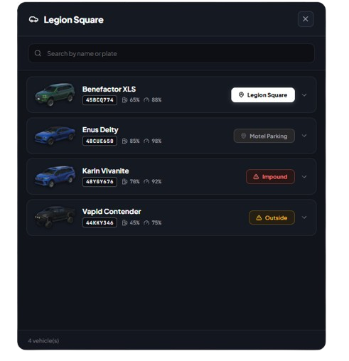
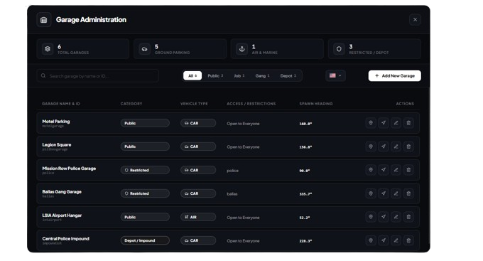
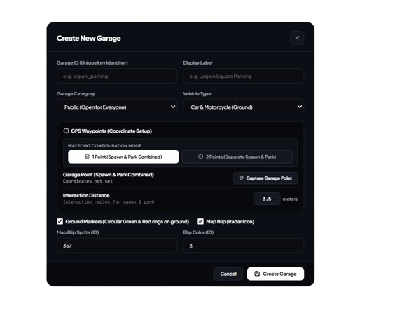

# qbx_garages (v2.0 - Modern NUI Edition)

Advanced, high-performance garage and vehicle management system for **Qbox Framework** featuring a standalone **React + Vite** frontend, ultra-clean *Noir Monochrome* aesthetic, in-game real-time Admin Manager, and comprehensive multi-language support.

---

## 📸 Previews

### 🚗 Modern Player Garage Interface
Compact, sleek vertical UI featuring vehicle CDN thumbnails, smart priority sorting, live telemetry stats, and one-click actions.



---

### 🛠️ In-Game Real-Time Admin Manager (`/admingarage`)
Comprehensive server management dashboard with metrics overview, quick teleportation, live filters, and multi-language switcher.



---

### 📍 Visual Garage Creation & GPS Setup Modal
Interactive modal supporting 1-point combined or 2-point separate spawn/park coordinates, live in-game capture, blip styling, and ground ring markers.



---

## Key Features

### Modern Player Garage Interface
- **JG Scripts-Inspired Layout**: Compact, intuitive vertical design optimized for modern gaming resolutions (1080p, 1440p, Ultrawide).
- **Auto Vehicle Thumbnails**: Automatic resolution of vehicle images directly from the FiveM CDN (`docs.fivem.net/vehicles/<model>.webp`).
- **Smart Priority Sorting**:
  - **1st Priority**: Vehicles stored in the current garage are always prioritized at the very top of the list.
  - **2nd Priority**: Garaged vehicles stored elsewhere.
  - **3rd Priority**: Vehicles currently out in the world or impounded.
- **4 Distinct Status Badges**:
  - **Current Garage**: Illuminated white badge with direct **"Drive Out"** action.
  - **Other Garage**: Subtle dark badge indicating the specific garage where the vehicle is stored.
  - **Outside**: Amber warning badge for vehicles currently spawned in the city.
  - **Impound**: Red alert badge showing the calculated release fee and direct claim button.
- **Live Vehicle Health & Telemetry**: Expandable drawer displaying real-time **Engine Health**, **Body Health**, and **Fuel Level** progress bars.
- **Instant Search**: Filter by vehicle brand, model name, plate number, or garage label in real-time.

---

### In-Game Admin Garage Manager (/admingarage)
- **Complete Administrative Dashboard**: Manage every garage on your server in-game without touching configuration files.
- **Real-Time Metrics Overview**: Instant statistics for Total Garages, Ground Parking, Air & Marine Facilities, and Restricted/Depot lots.
- **Live GPS Waypoint Configuration**:
  - **1 Point Mode (Combined)**: Fast single-point capture for spawn and store interactions with customizable radius distance.
  - **2 Points Mode (Separate)**: Independent capture for vehicle spawn location (+ heading) and vehicle store/park drop-off points.
- **In-Game Coordinate Capture**: One-click coordinate and heading capture directly from the admin's current ped position.
- **Visuals & Marker Toggles**:
  - In-game toggle to enable or disable in-game circular green & red ground markers (`drawMarker`).
  - Toggle map radar blips with custom Blip Sprite ID and Blip Color ID.
- **Quick Teleportation**: Instant teleport buttons to either interaction coordinates or vehicle spawn locations.
- **Non-Intrusive Delete Confirmation**: Custom confirmation dialog with transparent backdrop ensuring the server view is never darkened.
- **Live Server Sync**: All created, modified, or deleted garages synchronize instantly to all online players and persist automatically.

---

### Built-in Multi-Language System (i18n)
- **Flag Icon Selector**: Country flag selector dropdown placed right beside the *"Add New Garage"* button.
- **15+ Included Languages**:
  - English (US)
  - Indonesian
  - Spanish
  - German
  - French
  - Italian
  - Portuguese (BR)
  - Dutch
  - Polish
  - Turkish
  - Czech
  - Danish
  - Swedish
  - Japanese
  - Arabic
- **Persistent Preferences**: Selected language saves automatically in client `localStorage` (`qbx_garage_lang`) with instant UI updates.

---

## Requirements

- **FiveM Server Artifacts**: 7290 or higher
- [qbx_core](https://github.com/Qbox-project/qbx_core) (v1.19.0+)
- [qbx_vehicles](https://github.com/Qbox-project/qbx_vehicles) (v1.3.1+)
- [oxmysql](https://github.com/overextended/oxmysql)
- [ox_lib](https://github.com/overextended/ox_lib)

---

## Installation

1. Ensure all dependencies above are installed and started in your `server.cfg`.
2. Place `qbx_garages` inside your resources directory (e.g. `resources/[qbx]/[garage]/qbx_garages`).
3. Ensure the resource is started in `server.cfg`:
   ```cfg
   ensure qbx_garages
   ```
4. Production build files are already pre-compiled inside `web/dist/`. No extra build step is required for standard deployment!

---

## Commands & Permissions

| Command | Permission | Description |
| :--- | :--- | :--- |
| `/admingarage` | `admin` / `god` | Opens the In-Game Garage Administration Manager |

*Permissions can be customized in `server/manager.lua` using `qbx_core:HasPermission`.*

---

## Web Frontend Development (Optional)

If you wish to modify or customize the React UI:

1. Navigate to the `web` folder:
   ```bash
   cd web
   ```
2. Install dependencies:
   ```bash
   npm install
   ```
3. Start local development server with hot-reload:
   ```bash
   npm run dev
   ```
   *Open `http://localhost:5173` or `http://localhost:5174` in your browser. Includes a dev switcher in the bottom-left corner and realistic in-game preview backdrop.*
4. Build for production:
   ```bash
   npm run build
   ```

---

## Configuration Overview

- **`config/client.lua`**:
  - `enableClient`: Enable or disable the client-side interaction handler.
  - `engineOn`: Whether the vehicle engine turns on upon retrieval.
  - `drawGarageMarker` & `drawDropOffMarker`: Visual marker rendering functions.
- **`config/server.lua`**:
  - `autoRespawn`: Automatically return vehicles outside into their last parked garage on server restart.
  - `warpInVehicle`: Automatically warp player into the driver seat when taking out a vehicle.
  - `doorsLocked`: Automatically lock vehicle doors when spawned.
  - `garages`: Table containing default server garage definitions.

---

## Credits & License

- Original backend logic by the **Qbox Project Team**.
- Modern React + Vite UI, In-Game Admin Manager, and Internationalization by **MoonVera Roleplay**.
- Licensed under **GPL-3.0**.
